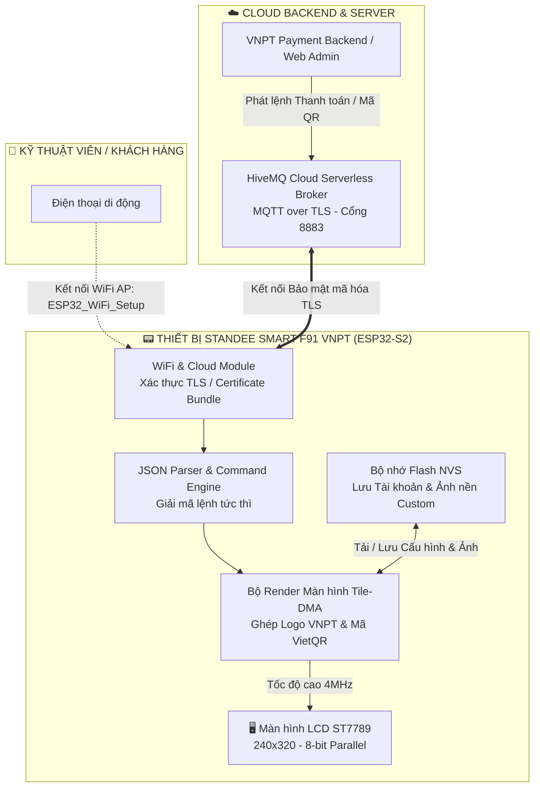
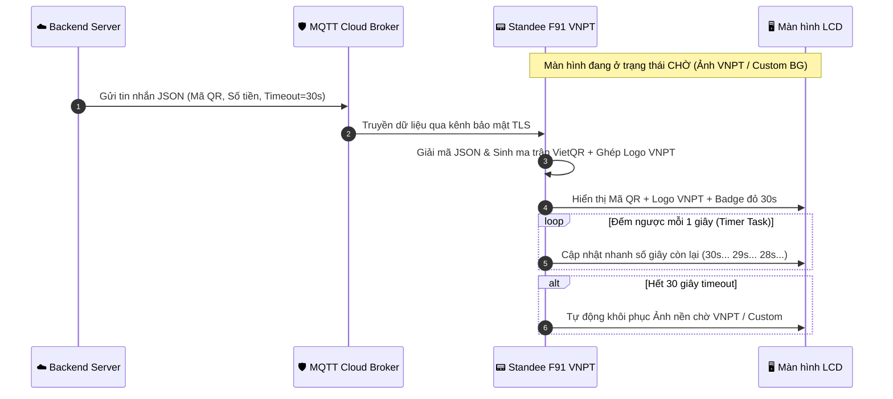

# F91 VNPT Standee Firmware v1.0 (ESP32-S2 + ST7789 8-bit Parallel)

Firmware điều khiển hiển thị và giao tiếp cho thiết bị **F91 VNPT Standee / Loa Thanh Toán Thông Minh** trên nền tảng vi điều khiển **ESP32-S2** và màn hình **ST7789** chuẩn giao tiếp song song 8-bit Intel 8080 ($240 \times 320$ pixel).

---

##  Tính Năng Nổi Bật

* **Màn hình chờ thương hiệu VNPT HD**: Nền trắng tinh khiết chuẩn $240 \times 320$ pixel với logo VNPT sắc nét, không viền rác.
* **Bộ sinh mã QR động Nayuki ISO/IEC 18004**: Tự động tạo mã QR chất lượng cao (ECC Quartile/Medium/Low) theo nội dung thanh toán gửi từ máy tính/POS, tích hợp logo VNPT ($36 \times 36$) ở tâm mã QR có **bo tròn 4 góc ($R=6\text{px}$)**.
* **Thanh Hướng Dẫn Banner Xanh**: Dải màu xanh VNPT trên cùng hiển thị dòng chữ trắng hướng dẫn **`QUET MA DE THANH TOAN`**.
* **Tích Hợp MQTT TLS Bảo Mật (HiveMQ Cloud Serverless)**:
  * Tự động kết nối bảo mật **MQTTS (Port 8883)** tới HiveMQ Cloud (`4a1375dbae154624a6759636e2559329.s1.eu.hivemq.cloud`).
  * Tự động đăng ký Topic nhận lệnh (`vnpt/f91/cmd`) và xuất báo cáo trạng thái (`vnpt/f91/status`).
  * Lưu trữ cấu hình HiveMQ vào NVS Flash và hỗ trợ thay đổi linh hoạt qua AT Command hoặc Web Config.
* **Bộ Giải Mã Lệnh JSON Thông Minh (`cJSON`)**:
  * Tự động nhận diện và giải mã lệnh định dạng JSON gửi từ MQTT hoặc Serial CDC.
* **Huy hiệu đếm ngược thời gian (Countdown Badge)**: Đếm lùi thời gian thực (30s, 29s, ..., 1s), tự động đóng mã QR và quay về màn hình chờ khi hết hạn.
* **Tích hợp Web Config & Captive Portal Tự Động**: 
  * Phát Wi-Fi SoftAP tên `ESP32_WiFi_Setup` (Mật khẩu: `12345678`).
  * Tự động nảy trang Web Cấu hình VNPT (`http://192.168.4.1`) hỗ trợ cài đặt cả Wi-Fi và HiveMQ Cloud.
  * Tự động đóng cửa sổ Pop-up Captive Portal ngay sau khi kết nối thành công.
* **Hỗ trợ Cấu Hình IP Tĩnh (Static IP)**: Cấu hình qua Web UI hoặc lệnh AT `AT+STATICIP=`.

---

## 📐 Sơ Đồ Kiến Trúc & Luồng Hoạt Động Hệ Thống

### 🏗️ 1. Sơ Đồ Kiến Trúc Hệ Thống Tổng Thể (System Architecture)

> **Lời thuyết minh cho Sếp**: *"Dự án của mình gồm 3 phần chính kết nối khép kín: **Cloud Backend Server** quản lý giao dịch, **Mạng Cloud MQTT TLS** truyền lệnh bảo mật, và **Thiết bị F91 VNPT** xử lý hiển thị trực quan."*



---

### 🔄 2. Sơ Đồ Luồng Thanh Toán VietQR Tự Động (QR Payment Flow)

> **Lời thuyết minh cho Sếp**: *"Khi có giao dịch thanh toán, Server gửi lệnh qua MQTT. Thiết bị nhận dữ liệu, tự động tạo mã VietQR có đính Logo VNPT và đếm ngược thời gian thanh toán. Khi hết giờ, màn hình tự động quay về ảnh nền chờ."*



---

### 🌐 3. Sơ Đồ Luồng Cấu Hình Mạng & Captive Portal (Smart Provisioning)

> **Lời thuyết minh cho Sếp**: *"Điểm cải tiến thông minh là quy trình cài đặt. Khi mới bật máy hoặc đổi mạng, thiết bị phát Wi-Fi để cài đặt. Trang cài đặt chỉ đóng khi kỹ thuật viên nhập ĐỦ cả Wi-Fi VÀ Server MQTT, giúp thiết bị không bao giờ rơi vào trạng thái mất kết nối nửa chừng."*

```mermaid
flowchart TD
    A([🚀 Bật nguồn thiết bị F91]) --> B{Kiểm tra Bộ nhớ Flash NVS}
    
    B -- Đã có đủ Wi-Fi & MQTT --> C[Kết nối Wi-Fi & MQTT TLS Cloud]
    C --> D{Kết nối thành công?}
    D -- Có --> E[🖥️ Hiển thị "MQTT CONNECTED" & Vào chế độ CHỜ]
    D -- Thất bại --> F[Phát Wi-Fi Cấu hình: ESP32_WiFi_Setup]

    B -- Thiếu Wi-Fi HOẶC MQTT --> F

    F --> G[📱 Người dùng dùng Điện thoại kết nối Wi-Fi & Mở trang Web Cấu hình]
    G --> H[Nhập SSID, Password Wi-Fi & Thông số MQTT Broker]
    H --> I{Kiểm tra dữ liệu nhập}
    I -- Đã nhập ĐỦ cả 2 --> J[Lưu vào Flash NVS & Đóng Wi-Fi AP & Khởi động lại]
    I -- Thiếu 1 trong 2 --> K[⚠️ Cảnh báo trên Web: Bắt buộc nhập đủ Wi-Fi & MQTT]
    K --> G
    J --> C
```

---

## Bảng Tập Lệnh Serial AT Commands Chi Tiết

Mọi lệnh AT được gửi qua cổng USB Serial CDC (Baudrate: `115200`, kết thúc bằng `\r\n` hoặc `\n`).

| STT | Câu lệnh AT | Cú pháp & Ví dụ | Mô tả chi tiết | Phản hồi từ thiết bị |
| :---: | :--- | :--- | :--- | :--- |
| **1** | `AT+VER` | `AT+VER` | Lấy thông tin phiên bản firmware đang chạy. | `+VER: F91_VNPT_STANDEE_V1.0`<br>`OK` |
| **2** | `AT+WIFI` | `AT+WIFI="SSID","PASSWORD"`<br>`AT+WIFI=MySSID,MyPassword` | Cấu hình và kết nối ngay tới mạng Wi-Fi.<br>- Tham số 1: Tên Wi-Fi (SSID).<br>- Tham số 2: Mật khẩu (Password). | `+WIFI: CONNECTING...`<br>*(Sau đó: `+WIFI: CONNECTED, IP=x.x.x.x, INTERNET=OK`)* |
| **3** | `AT+WIFISTATUS` | `AT+WIFISTATUS` | Xem trạng thái kết nối Wi-Fi & Địa chỉ IP hiện tại. | `+WIFISTATUS: CONNECTED_GOT_INTERNET, IP=192.168.1.50`<br>`OK` |
| **4** | `AT+PING` | `AT+PING` | Kiểm tra khả năng truy cập Internet thực tế. | `+PING: CHECKING INTERNET...`<br>`+PING: INTERNET OK (Google/Cloudflare reached)`<br>`OK` |
| **5** | `AT+STATICIP` | `AT+STATICIP=1,"192.168.1.100","255.255.255.0","192.168.1.1","8.8.8.8"`<br>`AT+STATICIP=0` | Cấu hình IP Tĩnh (Static IP) hoặc quay về DHCP. | `+STATICIP: ENABLED, IP=192.168.1.100, GW=192.168.1.1, DNS=8.8.8.8`<br>`OK` |
| **6** | `AT+MQTTCFG` | `AT+MQTTCFG="host",8883,"user","pass","sub_topic"` | Cấu hình thông số Broker MQTT TLS và lưu NVS. | `+MQTTCFG: OK, Host=..., Port=8883, SubTopic=...`<br>`OK` |
| **7** | `AT+MQTTSTATUS` | `AT+MQTTSTATUS` | Kiểm tra trạng thái kết nối MQTT HiveMQ Cloud. | `+MQTTSTATUS: CONNECTED, Host=..., Port=8883, SubTopic=...`<br>`OK` |
| **8** | `AT+MQTTPUB` | `AT+MQTTPUB="vnpt/f91/status","hello"` | Gửi dữ liệu tin nhắn tới Topic chỉ định trên MQTT. | `+MQTTPUB: OK`<br>*(hoặc `+MQTTPUB: ERROR (NOT_CONNECTED)`)* |
| **9** | `AT+QR` | `AT+QR=https://vnpt.vn,30`<br>`AT+QR="https://vnpt.vn",45` | Sinh và hiển thị mã QR thanh toán.<br>- Tham số 1: Nội dung mã QR.<br>- Tham số 2: Thời gian đếm ngược (giây). | `+QR: OK` |
| **10** | `AT+BG`<br>`AT+CLEAR` | `AT+BG`<br>`AT+CLEAR` | Quay về màn hình chờ VNPT ngay lập tức. | `OK` |
| **11** | `AT+DTIME=0` | `AT+DTIME=0` | Chuyển sang chế độ nhận luồng ảnh thô 153.600 bytes RGB565. | `OK`<br>*(Sau khi nhận đủ 150KB: `+DTIME: OK`)* |
| **12** | `AT+DTIME=<sec>` | `AT+DTIME=30` | Nhận luồng ảnh thô 153.600 bytes kèm đếm ngược `<sec>` giây. | `OK`<br>*(Sau khi nhận đủ 150KB: `+DTIME: OK`)* |
| **13** | `AT+APMODE`<br>`AT+WIFIRESET` | `AT+APMODE`<br>`AT+WIFIRESET` | Xóa cấu hình Wi-Fi NVS & bật SoftAP `ESP32_WiFi_Setup`. | `+WIFIRESET: ERASING NVS & OPENING SOFTAP...`<br>`OK` |
| **14** | `AT+WIFIRESTART`<br>`AT+WIFIRST` | `AT+WIFIRESTART` | Khởi động lại trình quản lý Wi-Fi. | `+WIFIRESTART: RESTARTING...`<br>`OK` |
| **15** | `AT+RST`<br>`AT+RESTART` | `AT+RST`<br>`AT+RESTART` | Khởi động lại vi điều khiển ESP32-S2. | `+RST: REBOOTING HARDWARE...`<br>`OK` |

---

## Định Dạng Chuỗi Lệnh JSON (JSON Command Parser)

Thiết bị tự động giải mã các gói tin JSON gửi qua MQTT Topic `vnpt/f91/cmd` hoặc truyền qua Serial CDC:

### 1. Lệnh Hiển Thị Mã QR
```json
{
  "cmd": "qr",
  "payload": "00020101021238540010A00000072701240006970415...",
  "timeout": 30
}
```
*(Cũng hỗ trợ key tương đương: `"action": "DISPLAY_QR"`, `"qr_data": "..."`)*

### 2. Lệnh Quay Về Màn Hình Chờ (Clear)
```json
{
  "cmd": "clear"
}
```

### 3. Lệnh Yêu Cầu Báo Cáo Trạng Thái (Status)
```json
{
  "cmd": "status"
}
```
Thiết bị sẽ tự động phản hồi dữ liệu JSON lên Topic `vnpt/f91/status`:
```json
{
  "device": "F91_VNPT_STANDEE",
  "firmware": "v1.0",
  "wifi_status": "CONNECTED_GOT_INTERNET",
  "ip": "192.168.1.50",
  "free_heap": 94120,
  "min_heap": 93800
}
```

### 4. Lệnh Khởi Động Lại (Reboot)
```json
{
  "cmd": "reboot"
}
```

---

## Sơ Đồ Chân Phần Cứng (Hardware Pinout)

Thiết bị sử dụng chip ESP32-S2 điều khiển màn hình ST7789 240x320 qua bus vi xử lý 8-bit Intel 8080:

### 1. Đường Dữ Liệu 8-bit (Data Bus D0 - D7)
| ST7789 Data Pin | ESP32-S2 GPIO |
| :---: | :---: |
| D0 | GPIO 10 |
| D1 | GPIO 9 |
| D2 | GPIO 8 |
| D3 | GPIO 7 |
| D4 | GPIO 6 |
| D5 | GPIO 5 |
| D6 | GPIO 3 |
| D7 | GPIO 2 |

### 2. Đường Điều Khiển Bus (Control Pins)
| Chân tín hiệu | ESP32-S2 GPIO | Trạng thái tích cực / Chức năng |
| :--- | :---: | :--- |
| **CS** (Chip Select) | GPIO 13 | Mức thấp (0) khi truyền lệnh/dữ liệu |
| **DC / RS** (Data/Command) | GPIO 12 | Mức thấp (0): Command / Mức cao (1): Data |
| **WR** (Write Enable) | GPIO 11 | Kích sườn xung lên ($0 \rightarrow 1$) để chốt byte |
| **RST** (Reset) | GPIO 18 | Reset cứng phần cứng ST7789 |
| **BK_LIGHT** (Backlight) | GPIO 21 | Mức cao (1): Bật đèn nền LED màn hình |

---

## Giấy Phép (License)
Phát triển bởi VNPT Standee Payment Firmware Team © 2026. Tất cả các quyền được bảo hộ.
